# Wicked Softball App

A live tournament companion for softball teams and families. Follow the next game, scores, standings, and bracket from one mobile-friendly dashboard, then revisit the full story of a season after it ends.

Built with vanilla JavaScript and Netlify Functions. Team and season data are configured per site, so the same codebase can serve more than one team without publishing rosters or results in Git.

<p align="center">
  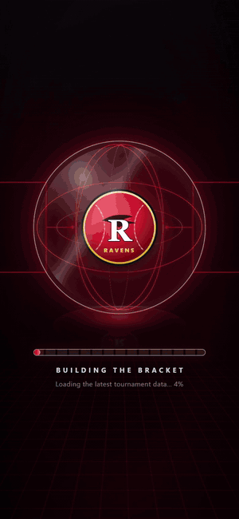
  <br><sub><a href="docs/media/demo.mp4">Full-resolution video (MP4)</a></sub>
</p>

> Every team, player, venue and score in these screenshots is fictional. They are generated from
> demo data by `scripts/readme-media/capture.mjs`.

## Game day

| | | |
|:-:|:-:|:-:|
| 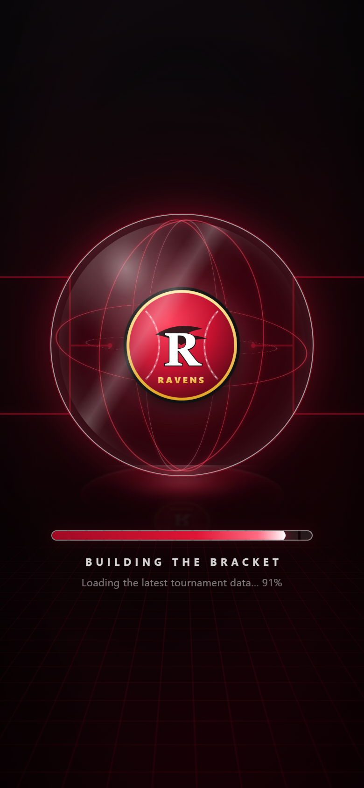<br>**Loading screen** | 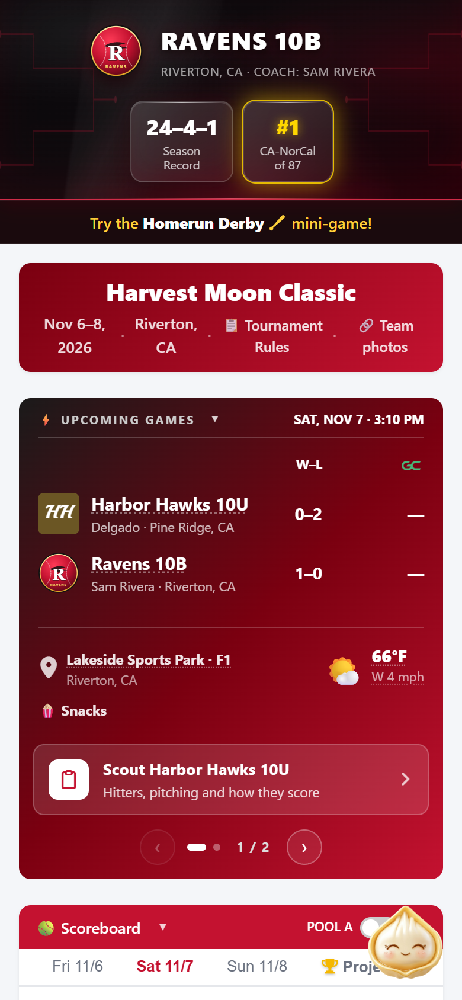<br>**Upcoming games, weather and the #1 rank celebration** | 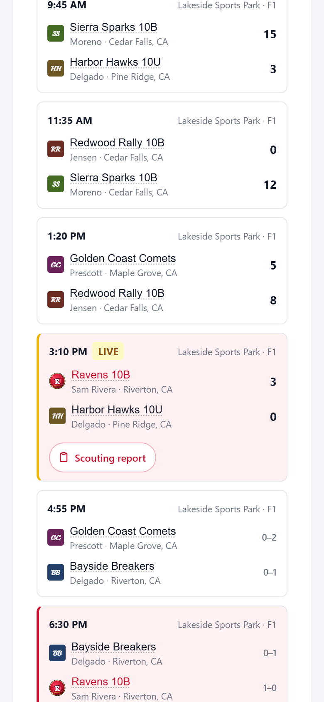<br>**Live scoreboard** |
| 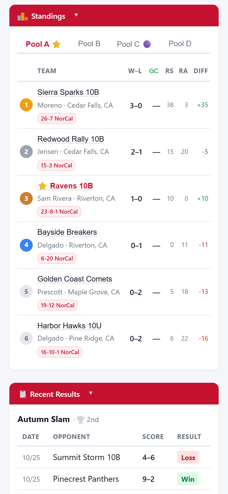<br>**Pool standings** | 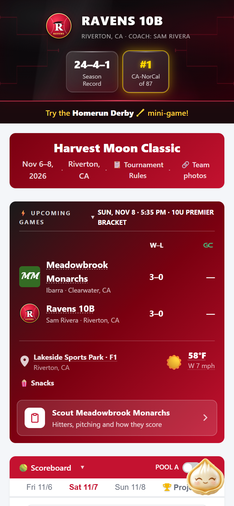<br>**Championship day** | 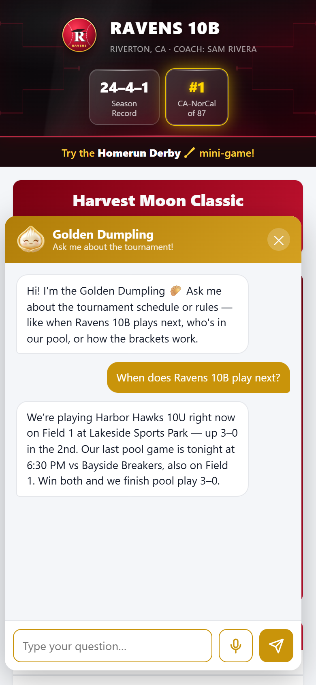<br>**Ask the Golden Dumpling** |

## Brackets

| Projected from the standings during pool play | Live on championship day |
|:-:|:-:|
| 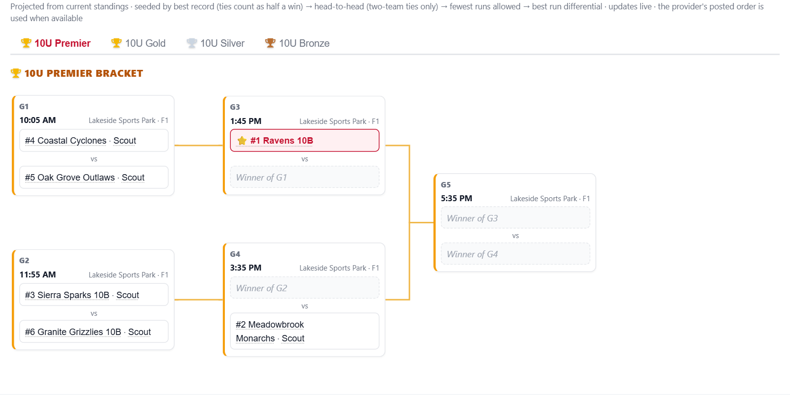 | 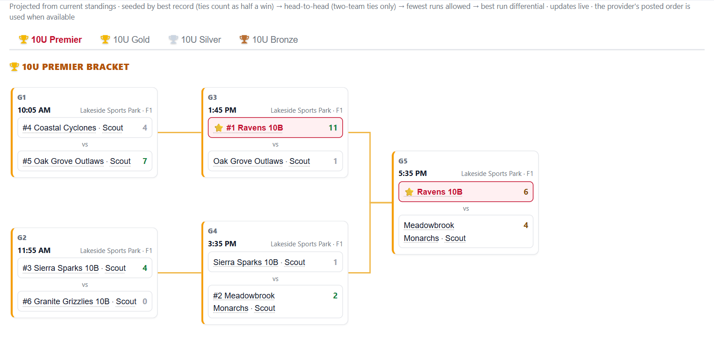 |

## Scouting reports

| | | |
|:-:|:-:|:-:|
| 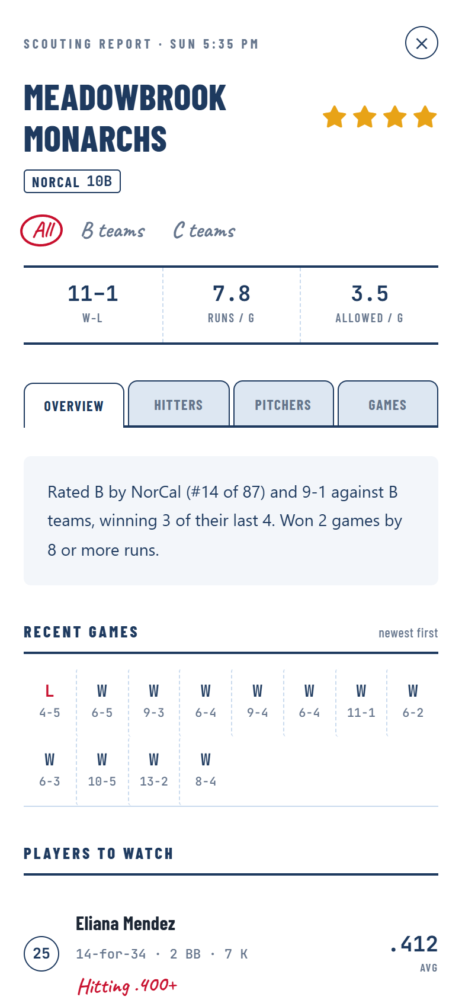<br>**Star rating, recent games, players to watch** | 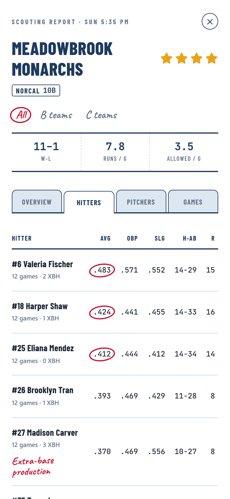<br>**Hitters** | 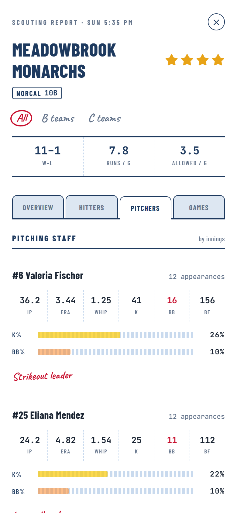<br>**Pitchers** |

## Season and extras

| | | |
|:-:|:-:|:-:|
| 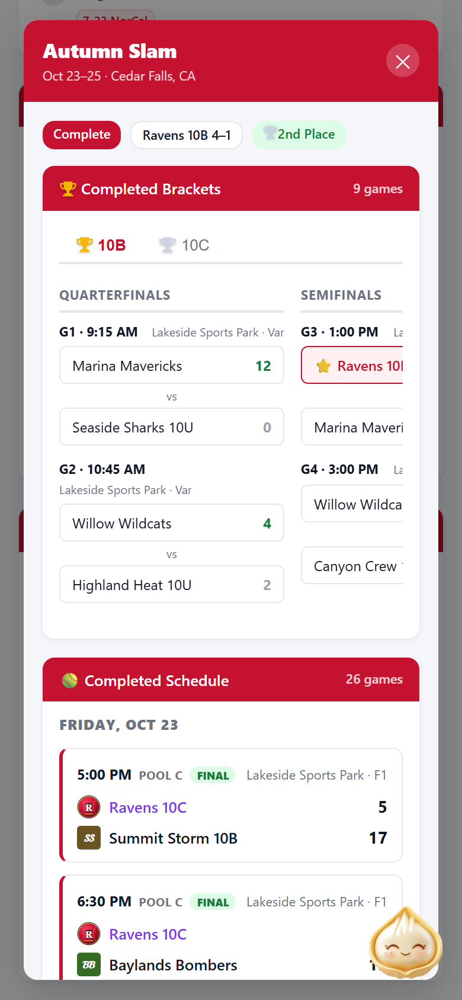<br>**Past tournaments** | 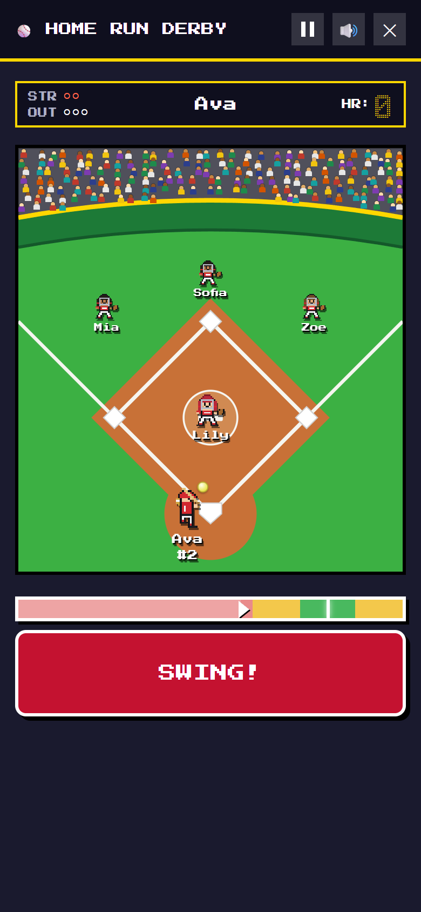<br>**Home Run Derby** | 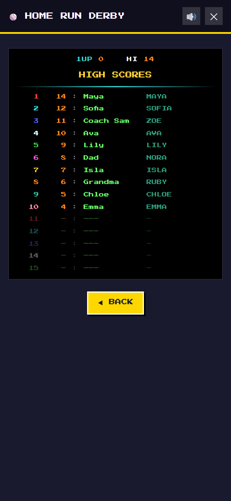<br>**Team leaderboard** |

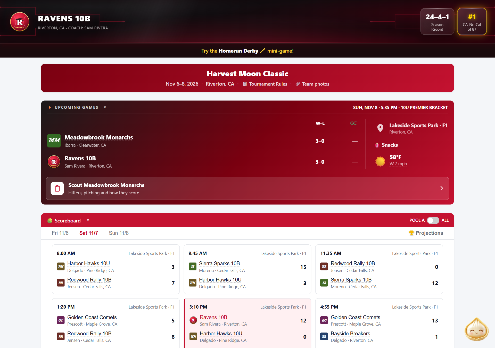

## Regenerating the screenshots

```bash
npm install --prefix netlify/functions
cd scripts/readme-media
npm ci
node capture.mjs
```

The capture uses Node.js 24 and serves the real `index.html` from a local demo server whose APIs answer with self-contained fictional
data, freezes the page clock mid-tournament, and writes everything in `docs/media/`. Pass `--shots`
or `--video` to capture only one. It uses your installed Chrome and needs `ffmpeg` on `PATH`; the first
video capture may also need `npx playwright install ffmpeg`. To click
around the demo yourself, run `node scripts/readme-media/demo-server.mjs` and open
http://localhost:3077.

## Product highlights

- **Game-day dashboard:** Swipe through upcoming pool games and the bracket winning path, with opponents, start times, fields, weather, and scouting links.
- **Standings and bracket outlook:** Follow pool records, runs scored and allowed, bracket assignments, and projected paths as tournament results arrive.
- **Tournament history:** Browse schedules, scores, standings, brackets, and placements from completed tournaments and seasons.
- **Homerun Derby:** Play with a roster configured for the selected season. Each season keeps its own leaderboard, including after the season is completed.
- **Score alerts:** Opt in to in-page or web-push notifications for individual games. Push notifications require additional site configuration.
- **Multi-team administration:** Create teams and seasons, configure tournaments and rosters, manage results, and choose which season appears on the default route.
- **Shared opponent directory:** Reuse verified team identities and seasonal GameChanger profiles across tournaments, with explicit matching and safe deletion.
- **Scouting reports:** Generate saved opponent reports from a manually supplied GameChanger token, including recent form, class-aware ratings, hitters, pitching, and possible bracket opponents.
- **Opponent details:** Edit an opponent’s display name, coach, city, state, and GameChanger link per tournament. Corrections apply to the dashboard, chat, score alerts, recent results, and completed-tournament overlays.
- **Provider integrations:** Tournament discovery and score updates support NorCal, Tourney Machine, and AST event sources. Optional GameChanger links and records enrich team details.
- **Optional chat assistant:** Ask about tournament information when an Anthropic API key is configured.

## How it works

The frontend is a single-page PWA in `index.html`. Netlify Functions discover tournament structure, refresh results, serve team-and-season snapshots, and handle administration. Site records—including rosters, leaderboards, and completed-season archives—live in that Netlify site's Blob stores. A new deployment starts with an empty catalog; no real team data is bundled with this repository.

## Getting started

1. Deploy this repository to a new Netlify site. Function dependencies are declared in `netlify/functions/package.json`.
2. Set a strong `ADMIN_SECRET` in the site's environment variables. `SETUP_SECRET` is supported as a fallback; never commit either value.
3. Open `/admin` on the deployed site and create a team, season, and tournament. Add a roster to enable Homerun Derby for that season.
4. Set the configured season active to show it on the site's default route.

Tournament discovery needs an appropriate provider event reference and team identity. A newly deployed site shows a coming-soon view until it is configured.

### Local development

For a local preview with the real functions and an in-memory Blob store, run `node scripts/dev-server.mjs` after installing the function dependencies. Open `http://localhost:3001/admin` and use the local-only secret `local-admin` (or the configured `ADMIN_SECRET`). Saves last only until the process exits; the catalog starts empty. Use Node.js 24 for this preview server.

Copy `.env.example` to `.env`, supply the values needed for the features you want to test, and run `netlify dev` with the Netlify CLI. A static file server can preview the interface but cannot run the functions or load site data. Run the included tests with Node.js 24. Several tests replace Netlify Blobs with an in-memory store, so install the function dependencies first:

```sh
npm install --prefix netlify/functions
node --experimental-test-module-mocks --test "tests/**/*.test.mjs" "tests/**/*.test.mts"
npm run typecheck --prefix netlify/functions
```

Scouting reports are generated or refreshed manually in `/admin`; the GameChanger token stays in page memory. Opening a saved report does not collect new data. Reports, opponent identities, and seasonal profiles remain in private Blob storage. See [scouting reports](docs/scouting-reports.md) for the report and data contract.

## Configuration

| Variable | Purpose |
| --- | --- |
| `ADMIN_SECRET` | Protects the admin API; falls back to `SETUP_SECRET` when unset. |
| `SETUP_SECRET` | Protects tournament setup and can serve as the admin/notification fallback. |
| `VAPID_PUBLIC_KEY`, `VAPID_PRIVATE_KEY`, `VAPID_SUBJECT` | Enable web push. The private key must remain in the site's environment. |
| `NOTIFY_SECRET` | Protects notification and refresh endpoints; falls back to `SETUP_SECRET`. `/notify` also accepts the admin page's credential (`ADMIN_SECRET`, or `SETUP_SECRET` when it is unset) for broadcasts. |
| `ANTHROPIC_API_KEY` | Enables the optional chat assistant. |
| `GEOCODE_USER_AGENT` | Identifies venue-coordinate lookups to OpenStreetMap Nominatim. |

For `GEOCODE_USER_AGENT`, use a stable app name and contact URL or email, such as `WickedSoftballApp/1.0 (https://example.com)`. Geocoding runs during tournament setup or rebuilds, not on every page view. Follow Nominatim's [public service policy](https://operations.osmfoundation.org/policies/nominatim/).

Keep `.env`, `.private/`, and `data/` out of Git. If connecting an existing site to this codebase, verify its catalog and archived snapshots in that site's Blob stores before switching deployments. Older single-team records are migrated only after a strongly consistent read confirms that no catalog exists; where the runtime can't provide one, `/admin` asks you to confirm the migration instead. See `.env.example` for local placeholders.

## License

The original source code and documentation are licensed under the [MIT License](LICENSE). Third-party logos, fonts, and audio in `assets/` are not covered by that license; confirm their redistribution rights separately.
